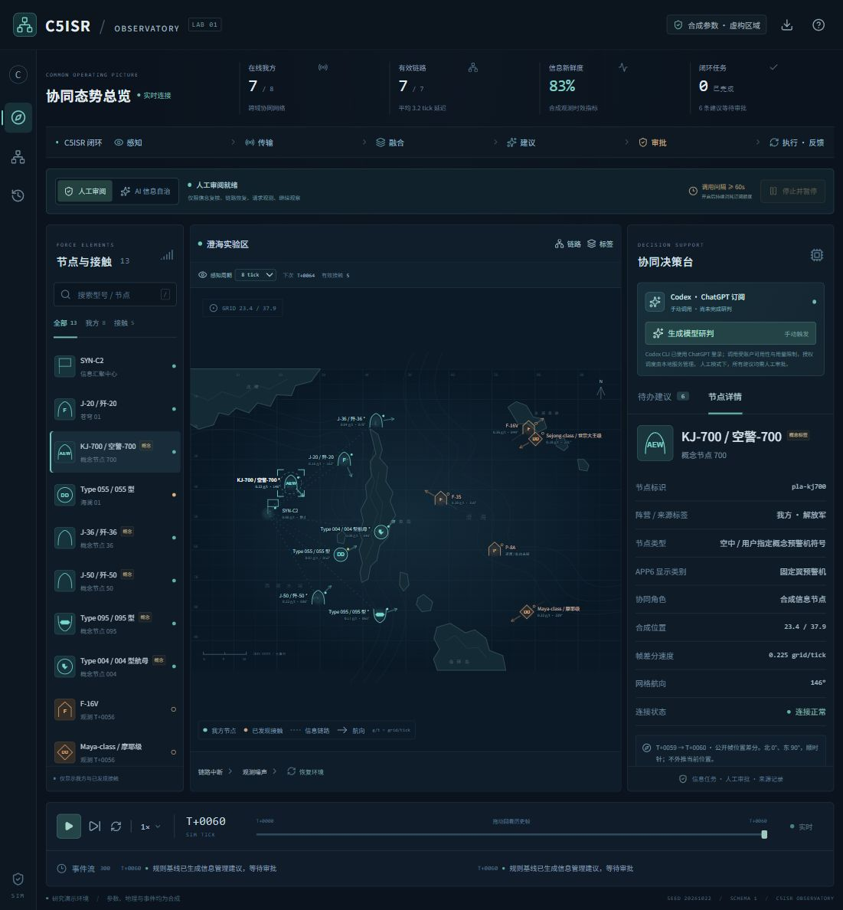
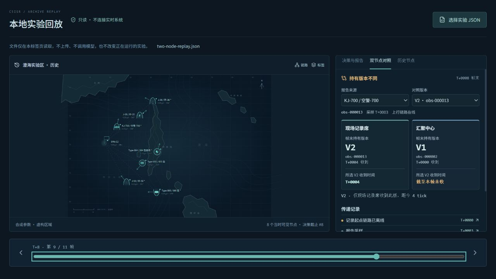

# C5ISR Observatory

本地运行的 C5ISR 信息与决策闭环研究演示。Rust 仿真内核 + 我方视角实时态势 + 人工审核 / 持续 AI 信息自治 + 可选 Codex 订阅模型研判。

装备 type 和名称使用现实或用户指定的概念符号；全部数值、空间、运动与结果是合成的。歼-36、歼-50、095、空警-700、004型航母被标为用户指定的概念符号，不宣称服役状态或真实能力。首版研究信息复核、链路恢复、补充观测和保持四类任务，不实现目标选择、武器分配或打击模型。



界面截图来自本地合成场景。双方域别符号见[符号图例](docs/images/symbol-legend.jpg)。

## 快速回放断链补报示例

示例记录了同一份报告在断链前后如何流转。可以先看两个节点在 T+8 各持哪个版本，再向前走一帧核对中心的收件时间。T 表示仿真步。

已启动应用时，点击右上角 **本地回放** 即可。首次克隆若只想看示例，安装 Node.js 24 和 pnpm 11.25.0 后运行以下命令。这个入口只需前端，浏览器在本机读取文件。

```powershell
git clone https://github.com/Nuclear2/c5isr-observatory.git
cd c5isr-observatory
pnpm install --frozen-lockfile
pnpm dev
```

打开[本地回放页](http://127.0.0.1:5173/?view=archive)。看完后可在终端按 `Ctrl+C` 停止前端。

1. 点击 **选择实验 JSON**，选取仓库中的 [examples/two-node-replay.json](examples/two-node-replay.json)。这是从验收导出中提取的只读示例，含 T+0 至 T+10 的 11 个公开态势帧，以及对应的决策和收件记录。
2. 把底部时间轴拖到 **T+1**，打开 **决策与报告**。展开空警-700 的 **请求断链节点补充信息 → 冻结依据与执行过程**。批准事件 `#4` 显示 **人工审核**。打开 **查看该事件冻结依据** 可读到批准时引用的链路状态报告 `obs-000008`。
3. 拖到 **T+8**，打开 **双节点对照**。将 **报告来源** 选为空警-700，**对照版本** 选为 V2（`obs-000013`）。并排查看现场记录席与信息汇聚中心，再点底部的 **下一历史帧** 切到 **T+9**。同一份报告在现场的收件时间是 T+4，在中心是 T+9，相差 5 个仿真步。

| 回放帧 | 现场记录席持有 | 信息汇聚中心持有 | V2 的进度 |
|---|---|---|---|
| T+0 | V1 | V1 | 初始版本为 `obs-000002` |
| T+3 | V1 | V1 | 空警-700 采样，补报离线暂存 |
| T+4 | V2 | V1 | 现场记录席收到 `obs-000013` |
| T+6 至 T+8 | V2 | V1 | T+6 恢复链路并发送，中心仍待收件 |
| T+9 | V2 | V2 | 中心实际收到 `obs-000013`，报告保留 T+3 的采样时间 |



## 从源码启动

新克隆的仓库不包含本地工具链 `.tools/`、前端构建产物 `dist/`、Rust 构建产物 `target/` 或 `node_modules/`。请先自行安装：

- Node.js 24；本地验证版本为 24.22.1。
- pnpm 11.25.0，与 [package.json](package.json) 的 `packageManager` 一致。
- 支持 Rust 2024 edition 的 Rust 工具链与 Cargo，以及目标平台所需的链接器。Windows 按所选 Rust 目标安装配套的 MSVC 或 GNU 构建工具；仓库未固定 Rust 编译器版本。

在仓库根目录安装依赖并构建。Windows PowerShell：

```powershell
pnpm install --frozen-lockfile
pnpm build
cargo build --locked -p c5isr-server
.\target\debug\c5isr-server.exe
```

打开 [http://127.0.0.1:8787](http://127.0.0.1:8787)，按 `Ctrl+C` 停止服务。前端由 Rust 服务托管，无需另开 Vite。服务仅监听本机地址；默认使用规则基线，未主动开启模型研判或 AI 信息自治时不会消耗模型用量。

Linux/macOS 在安装依赖并执行 `pnpm build` 后，可用 `cargo run --locked -p c5isr-server` 构建并启动。当前实际验证平台为 Windows，其他平台尚未做运行验收。

### Windows 已有构建产物

如果当前工作区已完成构建，可在仓库根目录直接运行：

```powershell
.\target\debug\c5isr-server.exe
```

该程序会使用**编译时的原项目路径**查找 `dist/`、`scripts/` 等资源，模型桥接还需要 `contracts/` 和 Node.js。它不是可单独复制分发的单文件程序；移动项目目录后应在新位置重新构建。

也可使用启动脚本；它会检查构建产物，缺失时自动构建：

```powershell
.\scripts\start.ps1
```

代码修改后执行 `.\scripts\start.ps1 -Build` 重新构建。脚本会优先使用工作区已有的 `.tools/`，否则使用系统安装的 Rust；它不会自动安装工具链或 npm 依赖。

若 PowerShell 提示禁止运行脚本，可仅为本次启动进程使用以下命令，无需永久修改执行策略：

```powershell
powershell.exe -NoProfile -ExecutionPolicy Bypass -File .\scripts\start.ps1
```

## 从 T+0 手动重演

启动上面的 Rust 服务，打开[实时界面](http://127.0.0.1:8787)。从默认种子 `20261022`、T+0、人工模式开始，保持时钟暂停及默认感知周期。若要重新开始已有实验，先用右上角 **导出实验记录** 保存需要的内容，再点击时间轴的 **重置当前实验**。整个例子使用规则基线，无需登录模型账户。

1. **T+0** 点击 **链路中断**。在底部时间轴点击一次播放键旁的 **推进一个仿真步**，到达 T+1。
2. **T+1** 在右侧 **建议与记录** 找到空警-700 的 **请求断链节点补充信息**，点击这项建议的 **批准执行**。继续单步推进 5 次，到 T+6 暂停操作。途中 T+3 完成采样，T+4 现场记录席收到 V2。
3. **T+6** 点击 **恢复环境**。推进 2 步到 T+8，打开 **双节点对照**，选空警-700 的 V2。再推进 1 步到 T+9，核对两边的版本和收件时间。此时在建议的 **冻结依据与执行过程** 中也能点开 **查看实际送达报告**，读到补报正文。
4. 再推进 1 步到 T+10，点击 **导出实验记录**。通过 **本地回放** 选择自己的导出文件，即可按[快速回放步骤](#快速回放断链补报示例)核对。时间轴选择帧，**决策与报告** 里的 **决策截止** 还可以按同一步内的事件序号查看审批前后的记录。

### 其他实验设置

实时界面初始显示 8 个本方节点，可选择节点查看合成状态、链路与证据。可按 1×/2×/4×/8× 播放，选择 4/8/16/32 步感知周期，或注入观测噪声。地图、API 和历史帧均采用本方已接收信息视角。接触位置来自最后收到的报告，距最后观测 48 步后归档。若补报传输丢失或样本满 60 步仍未送达，事件记录会显示结果。

时间轴最多保留 360 帧。生成与审批建议时会保存所引用的报告，之后仍可在保留的决策记录中阅读。旧归档可继续回看已有内容。缺少决策或收件记录时，对应页面会提示。

AI 模式仍仅处理本方信息复核、链路恢复、补充观测与保持，模型不接收对照接触、型号或坐标。两次调用开始至少间隔 60 秒墙钟时间，倍速不会加快消耗；模型研判期间仿真时钟保持，返回后继续推进。停止会暂停时钟、取消在途请求并作废其响应；已经批准的任务保留状态，之后手动恢复仿真时可继续。模型错误会停止自动模式，必须手动重新开启，不会自动降级成规则代理。

## 使用 ChatGPT 订阅模型

采用官方 **Codex CLI** 的已登录状态：

```powershell
codex login status
node scripts/codex-bridge.mjs status
```

登录状态需为 `Logged in using ChatGPT`。若尚未登录，运行 `codex login` 完成官方登录，然后重启本服务。手动研判按钮或用户显式开启的 AI 信息自治会消耗订阅用量；默认启动、普通仿真播放和自动化测试不会调用线上模型。AI 模式会持续调用直到停止或遇到错误。

调用使用订阅包含的 Codex 用量，并受账户权限、可用模型与速率限制约束，不保证无限或固定次数。桥接拒绝 API 登录，不读取或复制凭据文件。没有登录时，规则基线和其他仿真功能仍可使用。

人工模式建议先暂停仿真再调用模型，避免回答返回时证据已过期；AI 信息自治模式会在研判期间保持时钟。网络、额度、格式、重复建议、证据过期等失败会显示在界面，不会伪装成成功。

| 可选环境变量 | 用途 |
|---|---|
| `C5ISR_PORT` | 后端端口，默认 8787 |
| `C5ISR_CODEX_PATH` | 官方 Codex 可执行文件路径 |
| `C5ISR_NODE_PATH` | Node.js 可执行文件路径 |
| `C5ISR_DISABLE_MODEL=1` | 禁用线上模型，使用规则基线 |

详细协议与官方文档见 [模型接入说明](docs/model-integration.md)。

## 开发与验证

后端终端：

```powershell
. .\scripts\rust-env.ps1
cargo run -p c5isr-server
```

前端终端：

```powershell
pnpm dev
```

Vite 开发地址为 [http://127.0.0.1:5173](http://127.0.0.1:5173)，`/api` 代理到 8787。生产构建由 Rust 服务直接托管，不依赖 Vite 进程。

```powershell
. .\scripts\rust-env.ps1
cargo fmt --all -- --check
cargo test --workspace --locked
cargo build --locked -p c5isr-server
pnpm build
pnpm test:bridge
node --test web/*.test.mjs
node --test tests/http.test.mjs
```

`http.test.mjs` 启动独立临时端口服务，并明确禁用模型。测试审批约束、执行反馈、SSE、故障恢复、暂停和请求边界。

地图、列表和详情统一使用 `milsymbol 3.0.4` 的 APP6 符号，框形同时区分阵营与空中、水面、水下等域；使用说明提供双方符号对照。装备类型通过固定映射选择库内符号，不自行绘制飞机或船只轮廓。航向由独立箭头指示，速度单位为 `grid/tick`。本方速度取自相邻公开帧；接触速度只根据两次已收到报告的采样位置和时间估算，首次报告显示未知。详情中可查看航向及计算依据；这些显示不使用隐藏真值，也不代表现实装备参数。配色和运动标注是本应用的显示约定，不声明整个界面完整符合 APP-6 标准。

## 项目地图

| 路径 | 职责 |
|---|---|
| `crates/sim-core` | 可测试的合成仿真内核 |
| `crates/server` | HTTP/SSE、播放时钟、模型任务与导出 |
| `web` | 中文态势界面、地图、时间轴和审阅 |
| `contracts` | 前端数据契约、模型 JSON Schema |
| `scripts` | 本地启动、Rust 环境、Codex 适配器 |
| `examples` | 可在本地回放页打开的双节点断链补报示例 |
| `tests` | 桥接与 HTTP 验收测试 |
| `docs` | 架构、来源和设计决策 |

新 agent 从 [AGENTS.md](AGENTS.md) 开始。并行开发先按目录分工，跨层修改先更新契约。相关文档：

- [架构与接口](docs/architecture.md)
- [公开研究依据与推断边界](docs/research-foundations.md)
- [模型与订阅接入](docs/model-integration.md)
- [设计决策](docs/decisions.md)
- [验收结果与演示记录](docs/verification.md)

公开研究目前覆盖中美负责任军事 AI 原则、NIST 风险管理、NASA 仿真可信度、DDS 与 W3C 数据来源概念。它们用于系统工程设计，不构成作战理论、军事逼真度或现实预测能力验证。

## 仓库内容与许可

仓库保留源码、依赖锁文件、协作说明、经过检查的界面截图，以及 `examples/` 中的合成回放示例。个人导出的实验 JSON、模型运行日志、凭据、本地工具链、依赖目录和构建产物均留在各自工作区。

项目采用 [MIT License](LICENSE)，与 Cargo 工作区声明一致。第三方依赖保留各自许可证；`milsymbol` 为按公开符号标准绘制图形的第三方库，不代表本应用获得官方认证。
