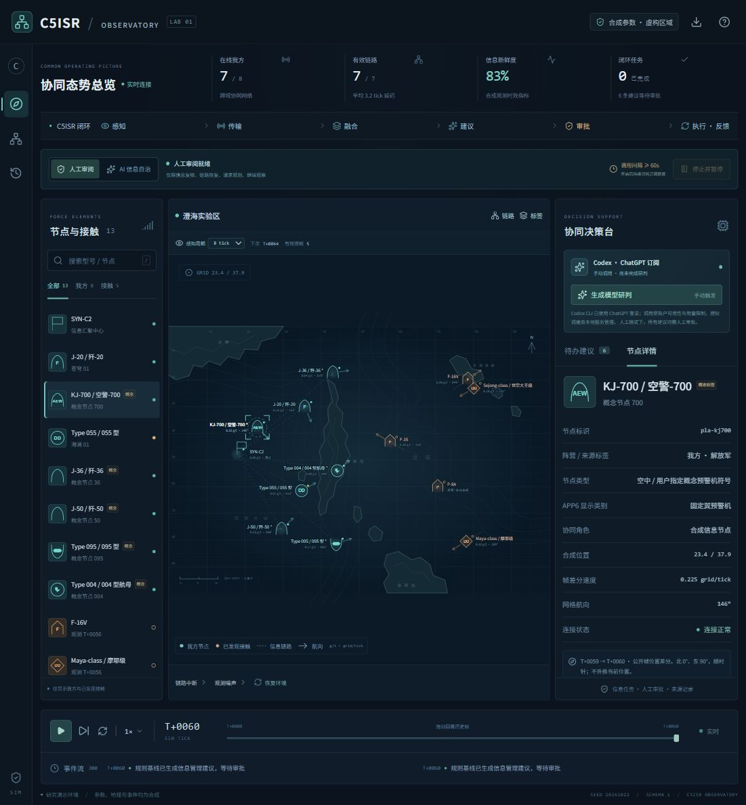

# C5ISR Observatory

本地运行的 C5ISR 信息与决策闭环研究演示。Rust 仿真内核 + 我方视角实时态势 + 人工审核 / 持续 AI 信息自治 + 可选 Codex 订阅模型研判。

装备 type 和名称使用现实或用户指定的概念符号；全部数值、空间、运动与结果是合成的。歼-36、歼-50、095、空警-700、004型航母被标为用户指定的概念符号，不宣称服役状态或真实能力。首版研究信息复核、链路恢复、补充观测和保持四类任务，不实现目标选择、武器分配或打击模型。



界面截图来自本地合成场景。双方域别符号见[符号图例](docs/images/symbol-legend.jpg)。

## 从源码启动

新克隆的仓库不包含本地工具链 `.tools/`、前端构建产物 `dist/`、Rust 构建产物 `target/` 或 `node_modules/`。请先自行安装：

- Node.js 24；本地验证版本为 24.22.1。
- pnpm 11.25.0，与 [package.json](package.json) 的 `packageManager` 一致。
- 支持 Rust 2024 edition 的 Rust 工具链与 Cargo，以及目标平台所需的链接器。Windows 按所选 Rust 目标安装配套的 MSVC 或 GNU 构建工具；仓库未固定 Rust 编译器版本。

在仓库根目录安装依赖并构建。Windows PowerShell：

```powershell
pnpm install --frozen-lockfile
pnpm build
cargo build --locked -p c5isr-server
.\target\debug\c5isr-server.exe
```

打开 **http://127.0.0.1:8787**，按 `Ctrl+C` 停止服务。前端由 Rust 服务托管，无需另开 Vite。服务仅监听本机地址；默认使用规则基线，未主动开启模型研判或 AI 信息自治时不会消耗模型用量。

Linux/macOS 在安装依赖并执行 `pnpm build` 后，可用 `cargo run --locked -p c5isr-server` 构建并启动。当前实际验证平台为 Windows，其他平台尚未做运行验收。

### Windows 已有构建产物

如果当前工作区已完成构建，可在仓库根目录直接运行：

```powershell
.\target\debug\c5isr-server.exe
```

该程序会使用**编译时的原项目路径**查找 `dist/`、`scripts/` 等资源，模型桥接还需要 `contracts/` 和 Node.js。它不是可单独复制分发的单文件程序；移动项目目录后应在新位置重新构建。

也可使用启动脚本；它会检查构建产物，缺失时自动构建：

```powershell
.\scripts\start.ps1
```

代码修改后执行 `.\scripts\start.ps1 -Build` 重新构建。脚本会优先使用工作区已有的 `.tools/`，否则使用系统安装的 Rust；它不会自动安装工具链或 npm 依赖。

若 PowerShell 提示禁止运行脚本，可仅为本次启动进程使用以下命令，无需永久修改执行策略：

```powershell
powershell.exe -NoProfile -ExecutionPolicy Bypass -File .\scripts\start.ps1
```

## 体验闭环

1. 初始场景暂停，只显示 8 个本方节点。选择节点，查看合成状态、链路与证据。
2. 点击运行或单步，观察消息传输、延迟与态势更新；选择 1×/2×/4×/8×播放。隐藏的对照符号会持续生成，只有收到观测报告后才成为可见接触；可选择 4/8/16/32 步感知周期。
3. 注入链路中断或传感噪声，检查信息质量变化。
4. 审阅规则基线建议，或手动点击模型研判。模型建议只有在验证通过后才进入待审列表。
5. 人工模式中批准一项建议，再推进仿真步，查看执行与反馈。或显式开启 AI 信息自治：模型连续研判、校验后的本轮信息任务自动批准并执行，直到停止或遇到错误。
6. 暂停后拖动时间轴，回看已保留的节点、链路和指标。回看期间修改操作禁用。
7. 导出实验 JSON，保存快照、命令日志和模型最终结果。

地图、API 和历史帧均采用本方已接收信息视角，不包含隐藏对象真值。红方位置是最后收到的报告位置；停止刷新后，距最后观测 48 步到期归档，从当前态势移除。归档不表示打击或摧毁；感知周期也不是经过军事理论校准的 OODA 时间。时间轴最多保留 360 帧，事件和观察也是滚动窗口。旧证据移出窗口后，导出文件不包含其正文。进程退出会丢失尚未导出的实验；首版没有归档导入功能。

AI 模式仍仅处理本方信息复核、链路恢复、补充观测与保持，模型不接收对照接触、型号或坐标。两次调用开始至少间隔 60 秒墙钟时间，倍速不会加快消耗；模型研判期间仿真时钟保持，返回后继续推进。停止会暂停时钟、取消在途请求并作废其响应；已经批准的任务保留状态，之后手动恢复仿真时可继续。模型错误会停止自动模式，必须手动重新开启，不会自动降级成规则代理。

## 使用 ChatGPT 订阅模型

采用官方 **Codex CLI** 的已登录状态：

```powershell
codex login status
node scripts/codex-bridge.mjs status
```

登录状态需为 `Logged in using ChatGPT`。若尚未登录，运行 `codex login` 完成官方登录，然后重启本服务。手动研判按钮或用户显式开启的 AI 信息自治会消耗订阅用量；默认启动、普通仿真播放和自动化测试不会调用线上模型。AI 模式会持续调用直到停止或遇到错误。

调用使用订阅包含的 Codex 用量，并受账户权限、可用模型与速率限制约束，不保证无限或固定次数。桥接拒绝 API 登录，不读取或复制凭据文件。没有登录时，规则基线和其他仿真功能仍可使用。

人工模式建议先暂停仿真再调用模型，避免回答返回时证据已过期；AI 信息自治模式会在研判期间保持时钟。网络、额度、格式、重复建议、证据过期等失败会显示在界面，不会伪装成成功。

| 可选环境变量 | 用途 |
|---|---|
| `C5ISR_PORT` | 后端端口，默认 8787 |
| `C5ISR_CODEX_PATH` | 官方 Codex 可执行文件路径 |
| `C5ISR_NODE_PATH` | Node.js 可执行文件路径 |
| `C5ISR_DISABLE_MODEL=1` | 禁用线上模型，使用规则基线 |

详细协议与官方文档见 [模型接入说明](docs/model-integration.md)。

## 开发与验证

后端终端：

```powershell
. .\scripts\rust-env.ps1
cargo run -p c5isr-server
```

前端终端：

```powershell
pnpm dev
```

Vite 开发地址为 http://127.0.0.1:5173，`/api` 代理到 8787。生产构建由 Rust 服务直接托管，不依赖 Vite 进程。

```powershell
. .\scripts\rust-env.ps1
cargo fmt --all -- --check
cargo test --workspace --locked
cargo build --locked -p c5isr-server
pnpm build
pnpm test:bridge
node --test web/motion.test.mjs web/symbology.test.mjs
node --test tests/http.test.mjs
```

`http.test.mjs` 启动独立临时端口服务，并明确禁用模型。测试审批约束、执行反馈、SSE、故障恢复、暂停和请求边界。

地图、列表和详情统一使用 `milsymbol 3.0.4` 的 APP6 符号，框形同时区分阵营与空中、水面、水下等域；使用说明提供双方符号对照。装备类型通过固定映射选择库内符号，不自行绘制飞机或船只轮廓。航向由独立箭头指示，速度单位为 `grid/tick`。本方速度取自相邻公开帧；接触速度只根据两次已收到报告的采样位置和时间估算，首次报告显示未知。详情中可查看航向及计算依据；这些显示不使用隐藏真值，也不代表现实装备参数。配色和运动标注是本应用的显示约定，不声明整个界面完整符合 APP-6 标准。

## 项目地图

| 路径 | 职责 |
|---|---|
| `crates/sim-core` | 可测试的合成仿真内核 |
| `crates/server` | HTTP/SSE、播放时钟、模型任务与导出 |
| `web` | 中文态势界面、地图、时间轴和审阅 |
| `contracts` | 前端数据契约、模型 JSON Schema |
| `scripts` | 本地启动、Rust 环境、Codex 适配器 |
| `tests` | 桥接与 HTTP 验收测试 |
| `docs` | 架构、来源和设计决策 |

新 agent 从 [AGENTS.md](AGENTS.md) 开始。并行开发先按目录分工，跨层修改先更新契约。相关文档：

- [架构与接口](docs/architecture.md)
- [公开研究依据与推断边界](docs/research-foundations.md)
- [模型与订阅接入](docs/model-integration.md)
- [设计决策](docs/decisions.md)
- [验收结果与演示记录](docs/verification.md)

公开研究目前覆盖中美负责任军事 AI 原则、NIST 风险管理、NASA 仿真可信度、DDS 与 W3C 数据来源概念。它们用于系统工程设计，不构成作战理论、军事逼真度或现实预测能力验证。

## 仓库内容与许可

仓库保留源码、依赖锁文件、协作说明和经过检查的界面截图；本地工具链、依赖目录、构建产物、实验 JSON、模型运行日志及凭据均不提交。历史验收记录注明了仅保存在原工作区的证据文件。

项目采用 [MIT License](LICENSE)，与 Cargo 工作区声明一致。第三方依赖保留各自许可证；`milsymbol` 为按公开符号标准绘制图形的第三方库，不代表本应用获得官方认证。
