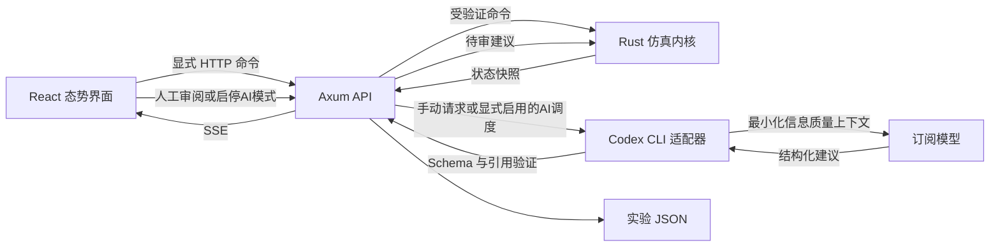

# C5ISR Observatory 架构

状态：2026-10-22 动态接触与双模式实现说明。应用运行于本机，用于观察信息流、模型建议与人工/自动审阅如何形成闭环。

## 1. 范围与语义

型号和 type 是展示元数据，模型规则不能按型号分支。所有坐标为 0–100 的无量纲网格，时间为仿真步，质量/置信度为合成的 0–1 指标；没有真实速度、探测距离、武器射程、毁伤概率或现实地理。界面蓝色代表本方符号，红色代表对照方符号，不声称采用任何国家的正式标绘标准。

任务只有信息复核、链路恢复、补充观测和保持。闭环是“生成观察 → 传输 → 更新态势 → 产生建议 → 人工审批或显式启用的自动审批 → 抽象任务执行 → 反馈”。不包含攻击链或真实作战效能模型。

## 2. 技术选择

| 层 | 选择 | 原因 |
|---|---|---|
| 领域内核 | Rust 独立 crate | 强类型、纯状态转移、便于测试，保留以后并行实验的余地 |
| 服务 | Axum + Tokio | 单机异步调度、HTTP 命令、SSE 快照；不在首版引入分布式系统 |
| 前端 | React + TypeScript + Vite | 明确的状态与 DTO，便于多人拆分组件 |
| 地图 | SVG + milsymbol 3.0.4 | 小规模节点易于交互；APP6 符号由固定版本库生成，离线可用，无地图服务或真实坐标依赖 |
| 模型桥接 | Node.js + 官方 Codex CLI | 复用已登录的 ChatGPT/Codex 订阅入口，不复制认证材料 |
| 实验数据 | 内存 + JSON 导出 | 首版是单用户实验，避免数据库部署负担；历史快照供回看 |

原开发环境未安装 Rust，因此曾将工具链放在本地 `.tools/`，不修改系统 PATH；Windows GNU 的汇编器由本地 w64devkit 2.10.1 补齐（从原项目 GitHub Release 下载并比对 SHA-256），链接使用 Rust 自带的 GNU 驱动和运行库，避免混用另一套 GCC 异常处理库。这是原开发环境的配置记录；GitHub 仓库不包含 `.tools/` 或上述工具链，新克隆需按 [README](../README.md) 自行安装 Node.js、pnpm、Rust 和目标平台所需的构建工具。`scripts/rust-env.ps1` 仅在已有本地工具链时为当前进程配置路径，否则使用系统 Rust，不负责安装工具链。依赖精确解析由两个 lockfile 固定。

## 3. 组件与数据流

`sim-core` 不依赖网络、文件或模型；`Engine::step` 始终推进一个仿真步。Tokio 调度器根据 running/speed 每个墙钟秒推进 1/2/4/8 个仿真步，墙钟只负责播放速度，不参与领域随机数。

服务器是状态的唯一写入者，通过互斥锁串行化命令。模型调用先复制输入并释放锁，暂停/查询仍可用；返回时检查 run_id、输入年龄、结构和引用，场景重置后的旧响应不能注入新场景。每次只允许一个模型请求，避免重复消耗订阅额度。

### 感知与隐藏状态

内核将隐藏环境、待接收报告与公开态势分开。初始公开态势只有 8 个本方节点；隐藏符号从运行后开始按独立种子随机流生成，约每 12 步一个，寿命 40–56 步。扫描默认每 8 步，可设为 4/8/16/32 步，并带有合成漏报。扫描报告仍需通过本方链路延迟/丢失流程；只有接收时才能创建或更新可见接触。

初始预警机节点为 `pla-kj700`（空警-700），水面节点包含 `pla-004`（004型航母），二者均是用户指定概念标签，`conceptual=true`。新增节点按同一通用规则获得合成信息链路、运动与状态，不根据型号添加现实能力。修改内核场景后须重新构建并重启服务；旧导出保留原有节点名称和数量。

隐藏类型与报告队列不序列化。公开接触坐标来自最近已接收报告，乱序旧报告不能回退位置或时间。`contact.first_seen_tick` 和 `last_seen_tick` 指采样时间，真正接收发现的时间由 `contact_discovered` 事件记录；`expires_tick=last_seen_tick+48`。到期接触归档并从当前态势移除，不会被迟到报告复活，历史帧仍保留当时已知状态。首次发现可触发对本方信息源的复核基线任务，不产生针对接触的动作。

### 持续 AI 信息模式

`AutomationStatus.mode` 默认 `manual`。用户显式切到 `ai` 后，服务器启动仿真并安排首轮模型任务；每次调用开始至少间隔 60 秒墙钟时间，且必须等待上一请求退出及已批准任务执行完。模型等待阶段保持仿真 tick 不变，以保持证据新鲜。返回后先校验，再只自动批准本次新增的 Codex 提案；此前基线或手动提案不被批量批准。桥接仍只看到匿名本方网络信息，与动态对照接触无关。

模式阶段为 idle / waiting / analyzing / executing / error。开始、模型请求、接受/失败、自动审阅和停止均进入 journal。用户停止、暂停或重置会撤销调度，暂停时钟，并先使在途响应失效；服务器向 `runtime/cancel/<唯一请求标识>.cancel` 写标记，桥接终止其拥有的进程树。`busy` 等待退出后才清除，不允许清理期间开启第二个请求。已批准任务保留，手动恢复时可继续。错误暂停自动模式，展示原因，不自动重试或改用基线。

Windows 外层运行器使用私有 Job Object 维护 Node 及其后代归属，通过 stdin 门槛保证归属建立后才开始登录/分析。总超时包含管道输入、输出和等待，异常时先请求协作取消再终止本次 Job；未确认退出不会释放 busy。服务关停信号同时停止时钟调度、结束 SSE 并等待模型清理。对应离线进程测试在 `crates/server/src/process_tests.rs`；Unix 进程组机制尚未获得等同的实际验证。

### 地图符号与运动显示

前端使用锁定版本 `milsymbol 3.0.4`，以 `standard: 'APP6'` 生成符号框和类型内符号。框按阵营与域共同选择：友方空中为开底弧框、水面为圆框、水下为开顶弧框；对照方空中为开底尖顶框、水面为菱形、水下为开顶尖底框。地面和空间也交由库按符号编码辨识。地图、列表、详情与使用说明中的对照图例共用映射与渲染。

本应用保留自定义暗色配色和独立运动箭头，不声明整个界面完整符合 APP-6 标准。符号本体固定朝向，独立箭头表达运动方向，避免把符号内图形误读为当前航向。参考 [milsymbol 官方项目](https://github.com/spatialillusions/milsymbol)、[符号几何实现](https://github.com/spatialillusions/milsymbol/blob/master/src/ms/symbolgeometries.js)与[方向箭头实现](https://github.com/spatialillusions/milsymbol/blob/master/src/symbolfunctions/directionarrow.js)。

显示适配器为 `web/symbology.ts`，公共组件为 `web/UnitSymbol.tsx`。编码使用 `S + F/H + 域 + P + 六位功能码 + -----` 的 15 字符 SIDC。F/H 由本方/对照方决定；功能码按 `type_label` 中的类别选择，未知类别保留通用域符号。该映射只参与显示，不改变内核行为。

| 类别 | 域 / 功能码 |
|---|---|
| 预警机 / 战斗机 / 巡逻机 | A / `MFRW--`、`MFF---`、`MFP---` |
| 航母 / 驱逐舰 | S / `CLCV--`、`CLDD--` |
| 潜艇、潜航符号 | U / `S-----` |
| 指挥节点 / 通用地面单位 | G / `UH----`、`U-----` |
| 卫星 / 通用空间符号 | P / `S-----`、`------` |

SVG 按 SIDC 与颜色缓存；使用库的尺寸与地图锚点等比缩放，指挥节点锚点位于旗杆末端。地图点击范围和标签偏移随图形边界调整。库同时提供域、阵营与几何元数据，`web/symbology.test.mjs` 验证编码有效性及双方域映射，防止退回统一矩形或菱形。库会按其当前规则解释兼容编码，不把 15 字符输入宣传为特定旧版标准的原样实现。

速度、航向完全由公开历史帧差分计算：本方使用相邻可用帧，对照接触使用两次不同采样时间的已接收报告。速度为无量纲 grid/tick；航向以北0°、东90°顺时针，地图箭头按 x×10、y×7 的相同投影绘制。初次报告或历史不足显示未知，静止时不伪造航向；不会读取隐藏环境速度，也不添加真实装备性能。

## 4. 契约与生命周期

前端 DTO 在 `contracts/state.ts`。Rust DTO 位于 `sim-core`；目前手工保持一致，由构建与 HTTP 验收测试检查关键字段。未来可引入类型生成，避免两个语言定义漂移。

- Unit：展示标签、阵营符号、合成位置与节点状态。
- Link：端点、可用性、合成质量与延迟。
- Observation：生成时间、接收时间、来源与合成置信度。
- Proposal：动作、依据、未知项、预期效果、来源、审核状态与反馈。
- Frame：用于回看的节点/链路/指标快照。
- ModelStatus：可用性、运行状态、错误、上次完成所依据的仿真步。
- Perception：扫描周期、下次扫描、当前可见接触数、累计发现/归档数；也保存在 Frame。
- AutomationStatus：模式、阶段、60 秒调用节奏、下次调用倒计时、本次模式会话接受轮数与自动批准数、停止错误。

建议生命周期为 pending → approved → executing → completed，另有 rejected 与 stale。审批必须检查当前状态；人工和自动审批共用内核校验。批准不等于完成，任务在后续仿真步执行并产生反馈。真实模型与规则基线必须分别标识。

## 5. 接口

| 方法/路径 | 用途 |
|---|---|
| GET `/api/health` | 服务就绪 |
| GET `/api/state` | 完整快照 |
| GET `/api/events` | SSE，事件名 `state` |
| POST `/api/control` | `{action:play\|pause\|step\|reset\|speed\|observation_cycle,value?:number}` |
| POST `/api/inject` | `{kind:link_loss\|sensor_noise\|recover}` |
| POST `/api/proposals/{id}/review` | `{approve:boolean}` |
| POST `/api/model/analyze` | 手动模型任务，202；通过 SSE 获取完成/错误 |
| POST `/api/automation` | `{mode:manual\|ai}`；manual 停止并暂停，ai 显式启用持续信息模式 |
| GET `/api/export` | 下载快照、命令日志、模型结果与来源标记 |

服务仅监听 127.0.0.1。开发前端通过 Vite 代理，构建后 Rust 直接服务 dist。HTTP 输入限制为 64 KiB；无认证的本地服务不能直接暴露到局域网或互联网。

## 6. 实验可复现性与边界

同种子、同领域命令序列的数值演化可复现。run_id 用于区分运行实例，服务另加启动标识以区分进程重启，这些标识不参加数值演算。外部模型输出本身不确定，因此导出保存已得到的最终建议与使用量；回看不重新调用模型。

界面的时间轴是滚动历史快照回看（最多 360 帧），不是完整事件溯源恢复。回看时节点/链路/指标采用历史帧，修改类操作被禁用。首次打开和进程重启不会恢复此前未导出的内存实验。JSON 导出保留本次命令与模型记录；首版不实现导入恢复。

观察置信度只是演示变量，不是经校准的概率；规则基线也不是军事理论算法。首版以确定性、状态约束、引用校验、故障可见性和 UI 行为为验收目标。依据与来源限制见 `research-foundations.md`。

## 7. 后续扩展顺序

1. 版本化场景文件与 schema 校验、导出文件导入回看。
2. 持久化实验存储与更多信息质量评测，补充端到端协议契约测试。
3. 从共享 DTO 生成 TS/Rust 类型，并把前端大组件进一步拆分。
4. 在同一非攻击性任务集合内加入多模型对比与可配置调用预算；本版已有单次请求取消与固定间隔。
5. 只有当单机实验规模确实需要时，再考虑数据库和分布式消息总线。

这些为规划项，不能在产品或交接中写成已实现。
